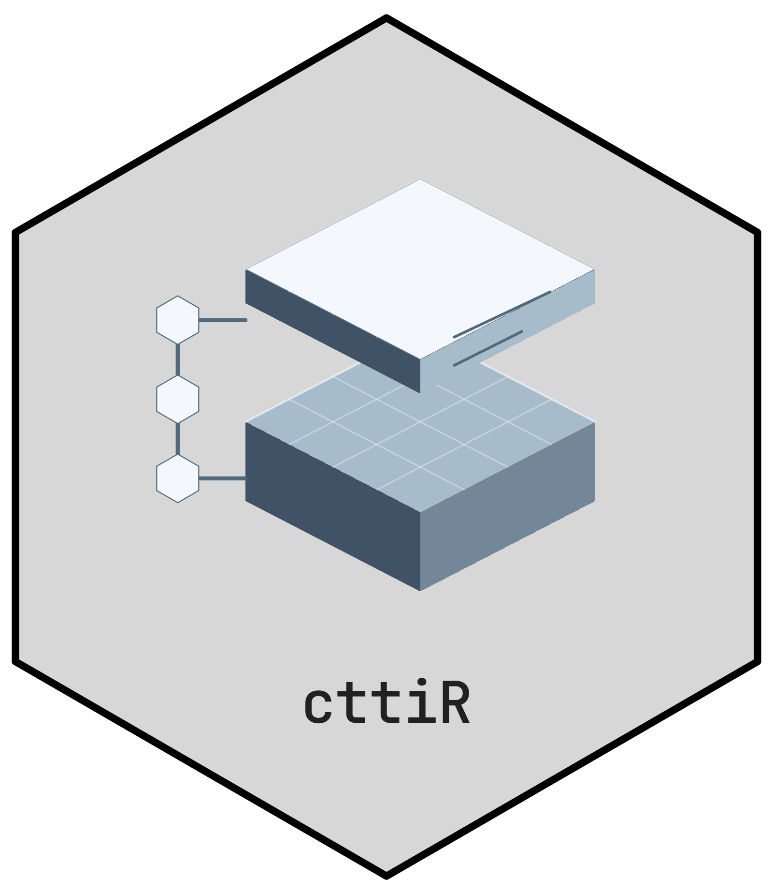

# cttiR <picture class="cttir-readme-logo"><source class="cttir-logo-dark-source" media="(prefers-color-scheme: dark)" srcset="man/figures/logo-with-name-dark.png" /></picture>

**CTTIR Project Builder — three inputs, one structured research project.**

cttiR creates a standardized research project from a name, a research type and
a goal, routes it to a reviewed analysis workflow, and keeps a revision-scoped
knowledge catalog of the packages that workflow is allowed to call.

```r
p <- cttiR::project(
  "Example Study", "primary_research",
  "Describe outcomes and plan an adjusted regression for a tabular cohort",
  path = tempdir()
)
p
```

`path` is an existing **parent** directory; this creates `example_study/`.
Use `dry_run = TRUE` for a read-only preview. Creation uses local resources by
default and does not read study data or install packages. An explicitly enabled
local planner can consult the configured local model.

## Strict study compilation

`study_spec()`, `study_project()`, `study_run()` and `study_render()` provide an
explicit, narrower workflow using reflowR's `strict-cttir-v1` profile. The first
recipe handles synthetic independent observations with a continuous outcome,
continuous exposure and declared continuous or categorical covariates. It fits
a noncausal adjusted association using `stats::lm`. Unsupported designs,
missing values, duplicate IDs, mismatched units and rank-deficient fits stop
before a report is accepted.

Prepare an installed external R library containing cttiR, reflowR and workflowr.
Create a specification with `study_spec()` and supply a data frame plus explicit
column units. Then retain each returned declaration **outside** the project:

```r
compiled <- cttiR::study_project(
  directory, spec, data, cttiR::study_dependency_lock(),
  author = "Research group", units = units
)
analyzed <- cttiR::study_run(compiled$directory, compiled$declaration)
reported <- cttiR::study_render(analyzed$directory, analyzed$declaration)
cttiR::study_validate_project(
  reported$directory, reported$declaration, require_render = TRUE
)
```

The compiler fixes all eleven stage locations, applicability reasons and the
research-domain palette. Each new study has its own Git repository so report
provenance cannot come from an enclosing repository. Only generated analysis
Rmd templates are staged, and no commit is created. Rendering rejects ambiguous
Git status instead of treating untracked directories as committed source.
Reports consume recorded results and verify input,
configuration, installed-writer and output hashes. Rendering does not rerun the
statistical fit. The dependency snapshot records installed versions; provision
the external library separately. Passing checks does not approve a real study,
establish scientific validity, commit files or publish the site.

The `strict-study-workflow` vignette gives a complete synthetic specification,
data example and the explicit compile, analyze and render sequence.

`study_paired_spec()` declares a separate synthetic paired mean-change recipe.
It requires an explicit `independent_pairs = TRUE` declaration and long-form
data with exactly one before and after measurement per pair ID. It matches by
ID, fixes the difference direction as after minus before, rejects incomplete
pairs and produces paired-specific reports through the same strict workflow.
The independence declaration is an assumption requiring review, not proof of
independence or a causal effect. This recipe does not extend the model's
qualified planning scope. The `strict-paired-study` vignette provides a complete
simulated example with shuffled rows and the compile, analyze and render steps.

`evidence_search()` and `evidence_resolve()` retrieve local source passages from
an externally pinned evidence registry. They preserve version and page/topic
locators, reject changed sources and exclude restricted documents. A trusted
host may supply `options(cttiR.evidence_registry = list(directory = ...,
manifest_sha256 = ...))` to include bounded passages in advice. Retrieval gives
documentation no execution authority and does not certify claim support or
current legal applicability.

## What a project contains

* `cttir-project.yml`, `cttir-lock.json` and ownership metadata; publication
  subprojects with their own analysis, manuscript, figure and table trees.
* The adapted reflowR layout and a reviewed stage library in `code/R/`:
  delimited import, structural checks, tidy role selection, DescrTab2 or base
  descriptive tables (no tests), accessible ggplot2/patchwork figures,
  lm/glm/nlme/survival adapters, diagnostics and broom effect estimates.
* `config/workflow.yml` with the routed profile, stages, approval status and
  dependency versions pinned from the catalog snapshot.
* `Rscript code/run_demo.R`: every stage on synthetic data, with each model
  adapter checked against an independent reference computation.
* `Rscript code/run_workflow.R`: study data only after mappings, reviewed model
  settings, recorded approval, a local binding and approved pinned packages are
  present — otherwise it lists exactly what is missing.
* Optional `targets` pipeline, renv environment (prepared in an isolated
  process) and Git initialisation of the project root only.

## Workflowr reporting

For a root workflowr site, choose the reporting backend explicitly:

```r
p <- cttiR::project(
  "Reporting Study", "primary_research", "Describe cohort measurements",
  path = tempdir(),
  options = list(workflow = list(
    reporting = "workflowr", reporting_preset = "standard", git = TRUE
  ))
)
```

The standard preset has eight stage pages plus an index; `"minimal"` has three
stage pages plus an index. Stages remain placeholders until their inputs and
reviewed implementation are available. Creation initializes the root Git
repository without staging or committing. Prepare the pinned dependencies
explicitly, then use `Rscript code/render_report.R` to preview the allowlisted
pages with workflowr reproducibility panels. Recorded result tables require
current input, code, configuration and output hashes. Rendering does not publish.
Existing projects retain their reporting backend until an explicit migration:

```r
migration <- list(workflow = list(reporting = "workflowr", git = TRUE),
                  knowledge = list(refresh = TRUE))
cttiR::sync(p$path, options = migration)                 # preview
cttiR::sync(p$path, options = migration, dry_run = FALSE) # apply after review
```

Catalog refresh here selects the active local snapshot without downloading. It
refuses changes to existing dependency revisions. Edited site configuration
conflicts; manuscripts and publication identities are preserved. Migration is
supported from the current generic bundle. Add `pipeline = "targets"` to schedule
computation. The workflowr scheduler checks content receipts on each explicit run,
reuses fresh results, and regenerates missing outputs. Rendering consumes those
results separately; missing prerequisites leave the study target blocked.

## Routing

The router selects `standard_reflowR` when no approved CTTIR specialist adapter
matches, `hybrid` when approved specialist stages cover part of the work, and
records specialist candidates without adapters as explicit gaps. Goal keywords
only suggest unset fields (recorded as `inferred` decisions); explicit options
always win, and nothing is approved by inference. Biological modalities list
Bioconductor and Seurat capabilities; clinical tabular goals never route there.

## Knowledge catalog and approvals

```r
cttiR::packages()                       # 62 package revisions with coverage and approvals
cttiR::search("nlme::lme")              # revision-scoped evidence
cttiR::ask("Fit a mixed model for repeated measures")
cttiR::resources("cytometry", repository = "Bioconductor")
```

The bundled catalog indexes 30 public CTTIR package roots and the standard
workflow family from verified CRAN, Bioconductor and R 4.6.1 sources. Reviewed
approvals bind each workflow role to an exact source revision with stored
reference topics and passing fixture tests; generated code calls only approved
APIs, which `audit()` re-checks. `ask()` answers from that catalog with cited,
validated snippets and reports gaps instead of inventing APIs.
`update()` refreshes registered local, GitHub, CRAN or Bioconductor sources into
new immutable snapshots (never installing packages); `rollback_knowledge()`
restores an earlier one. Project pins never change implicitly.

## Maintenance and checks

* `sync()` previews and applies explicit configuration changes and preserves
  edited user files.
* `audit()` runs a registry of installation, knowledge, project and standard
  workflow checks with an explicit repair allowlist; `doctor()` is the brief
  read-only subset. Readiness levels (`scaffold_ready` to `analysis_ready`)
  come from local evidence such as receipts and pinned versions.
* `setup()` prepares an owned, cloud-disabled Ollama runtime on Linux x86_64.
  The deterministic planner is the default. The recorded 7B CPU results are
  development evidence, pending fresh independent qualification on the shipped
  artifact. Automatic selection therefore blocks acquisition while no qualified
  model is available. Its conservative resource policy remains tested separately.
  Experimental explicit model use requires the unqualified-model acknowledgement;
  no model result approves a scientific analysis.
* `setup_release()` previews a reviewed release manifest and imports an exact
  GGUF only after explicit consent. Its checksum must come from a separately
  trusted release record. Offline import and resumable downloads are supported;
  import does not grant model qualification. No qualified release manifest is
  bundled yet.
* `runtime_storage()` inventories model downloads, blobs and retained release
  manifests. `runtime_cleanup()` removes only explicitly selected unreferenced
  downloads after a hash-bound preview; `runtime_stop()` separately previews
  and stops only the verified owned daemon. Neither removes model blobs or pins.
* `setup_app()` and `configure()` open the local Shiny application (Fast and
  Detailed creation with a bilingual questionnaire, Ask, Knowledge, Resources,
  Audit and Runtime views).

The Ask view offers optional local explanations and code suggestions. It requires
a separately qualified local model; when unavailable, catalog-based guidance
remains available. No qualified assistance model ships with this development
version. With a project selected, suggestions can be previewed as current and
proposed file contents. Applying requires a separate review action, rechecks the
preview and file hashes, and uses the project transaction journal. Conflicts block
application. Applying writes files only; it does not execute code or establish
scientific correctness.

Suggestion drafts support R scripts and a bounded Markdown/R Markdown subset:
prose, ordinary document metadata, standard output-format names, R chunks and
inline R. R code and supported chunk-option expressions receive static checks;
custom render hooks, child documents, figure-device overrides, other engines,
raw HTML/TeX and ambiguous fences are refused. Prose is retained verbatim and is
not checked for factual correctness. Static checks are not a rendering-safety
proof. Preview and apply never knit or execute the document.

See the vignettes for the getting-started walkthrough, the standard workflow,
knowledge and approvals, and audit/runtime/privacy. The development record is
in [CURRENT_STATE.md](https://github.com/CTTIR/cttiR/blob/main/CURRENT_STATE.md).

The [refined concept](CONCEPT.md) and [completion roadmap](ROADMAP.md) describe
the planned trained-model release, Hugging Face distribution, explicit Ollama
setup and actual workflowr integration. These are development targets; the
features and limitations below describe the current package.

## Limits

Approvals cover pinned package revisions and adapters, not scientific
conclusions. Prediction, causal, count, Bayesian and specialist CTTIR analyses
have no reviewed adapter yet and are reported as gaps. `ask()` matches keywords
and phrase patterns rather than a language model. The independent held-out v5
release measurement answered 11 of 14 supported requests (0.786), below the
pre-registered 0.9 threshold. Later same-author follow-ups include a 20-question
set with 11 of 12 supported capabilities approved; that approval-only score does
not establish executable-code validity or replace independent qualification.
The v5 failure remains an open readiness gate.

The opt-in local planner shows registered packages and aliases and removes
capability proposals without keyword evidence in the goal. Retained and omitted
IDs are recorded in project decisions. This conservative filter can miss valid
requests; it does not approve analyses. Model suggestions can vary even at fixed
settings and must be reviewed before analysis.
Runtime acquisition is verified on Linux x86_64 only.

MIT licensed.
## Installation and documentation

Install the development package and its rendered vignettes from GitHub:

```r
install.packages("remotes")
remotes::install_github("CTTIR/cttiR", build_vignettes = TRUE)
```

Start with `vignette("getting-started", package = "cttiR")`. The source guides
cover [project creation](https://github.com/CTTIR/cttiR/blob/main/vignettes/getting-started.Rmd), the
[standard workflow](https://github.com/CTTIR/cttiR/blob/main/vignettes/standard-workflow.Rmd),
[knowledge and approvals](https://github.com/CTTIR/cttiR/blob/main/vignettes/knowledge-and-approvals.Rmd), and
[audit, runtime and privacy](https://github.com/CTTIR/cttiR/blob/main/vignettes/audit-runtime-privacy.Rmd).
Use `help(package = "cttiR")` for the function reference and
`citation("cttiR")` for citation details. Report reproducible problems at
<https://github.com/CTTIR/cttiR/issues>.

The documentation site uses the shared CTTIR `themakR` template. Install
`pkgdown` and `themakR`, then run `pkgdown::build_site()` to render into `site/`.
Development installation and local documentation builds do not qualify a model
or approve a scientific analysis.

## Use of LLM tools

Where applicable, LLM tools were used for narrowly defined, non-authorial tasks:
copyediting, prose refinement, Markdown/LaTeX formatting, boilerplate scaffolding
(such as CI configurations and build scripts), and code refactoring. Tools included
[Chat AI](https://kisski.gwdg.de/leistungen/2-02-llm-service/), the KISSKI
(GWDG) service, and self-hosted **Mistral Small (24B, Apache-2.0)** served through
a local **vLLM architecture** on an Ubuntu Linux workstation with Intel
processors and NVIDIA GPUs. The self-hosted model ran locally, with no data sent
to third parties.

All scientific claims, methodological choices, analyses, interpretations and
conclusions remain the authors' own. Where applicable, LLM-generated material
must be reviewed and revised before inclusion, and references must be verified
against their DOI, arXiv ID or ISBN.

Local software setup: vLLM with Python/PyTorch, plus R and RStudio.

## Branding

Editable R artwork and regeneration instructions are in [tools/branding](https://github.com/CTTIR/cttiR/blob/main/tools/branding/README.md).
