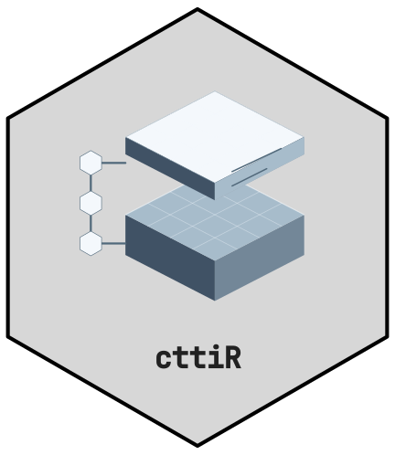
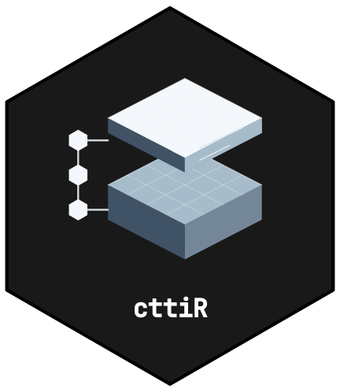

<!-- cttir-vignette-logo: start -->
<style>
.cttir-vignette-logo { float: right; width: 120px; max-width: 30%; margin: 0 0 1rem 1.5rem; }
.cttir-vignette-logo img { width: 100%; height: auto; border: 0; background: transparent; box-shadow: none; }
.cttir-vignette-logo .cttir-vignette-logo-light { display: block; }
.cttir-vignette-logo .cttir-vignette-logo-dark { display: none; }
@media (prefers-color-scheme: dark) {
  .cttir-vignette-logo .cttir-vignette-logo-light { display: none; }
  .cttir-vignette-logo .cttir-vignette-logo-dark { display: block; }
}
[data-bs-theme="light"] .cttir-vignette-logo .cttir-vignette-logo-light { display: block; }
[data-bs-theme="light"] .cttir-vignette-logo .cttir-vignette-logo-dark { display: none; }
[data-bs-theme="dark"] .cttir-vignette-logo .cttir-vignette-logo-light { display: none; }
[data-bs-theme="dark"] .cttir-vignette-logo .cttir-vignette-logo-dark { display: block; }
</style>
<div class="cttir-vignette-logo">
  
  
</div>
<!-- cttir-vignette-logo: end -->

```{r setup, include=FALSE}
knitr::opts_chunk$set(collapse = TRUE, comment = "#>")
```

This example estimates the mean within-pair change between two occasions.
The recipe matches observations by identifier, fixes the direction as after
minus before and performs a two-sided t test on the differences. It accepts
synthetic data only. A before-after contrast does not identify a treatment effect.

## Generate complete pairs

These are newly simulated values, not measurements from patients. The English
column names identify the pair, occasion and measurement. Each pair has two
correlated measurements, while pairs are independently generated.

```{r paired-data}
data <- withr::with_seed(20261017, {
  pair_id <- sprintf("example_%03d", seq_len(24))
  baseline <- stats::rnorm(24, mean = 120, sd = 12)
  difference <- stats::rnorm(24, mean = -3, sd = 5)
  values <- rbind(
    data.frame(pair_id = pair_id, visit = "baseline", pressure = baseline),
    data.frame(pair_id = pair_id, visit = "followup",
               pressure = baseline + difference)
  )
  values[sample(seq_len(nrow(values))), , drop = FALSE]
})
units <- c(pressure = "mmHg")
spec <- cttiR::study_paired_spec(
  study_id = "synthetic_paired_change",
  name = "Synthetic paired pressure example",
  question = "What is the mean followup-minus-baseline pressure change?",
  population = "Twenty-four independently generated synthetic pairs",
  pair_id = "pair_id", occasion = "visit",
  outcome = list(name = "pressure", type = "continuous", unit = "mmHg"),
  before = "baseline", after = "followup", independent_pairs = TRUE,
  research = list(domain = "clinical", data_origin = "primary",
                  design = "observational")
)
cttiR::study_validate(spec, data, units)
```

The shuffled row order is intentional: matching uses `pair_id`, not adjacent
rows. A real study would require scientific justification for independent
pairs; the explicit declaration is not a test or proof of independence.
Shared household or centre effects may require a different design and model.

The strict contract requires exactly the three declared columns, one measurement
per pair at each occasion, finite measurements and matching units. Incomplete
pairs, additional visits and duplicate pair-occasion records are rejected.
There is no silent exclusion, imputation or automatic switch of statistical test.

## Inspect the estimate

```{r paired-preview}
result <- cttiR::study_analyze(spec, data, units)
result$coefficients
c(pairs = result$n_pairs, rows = result$n, degrees_of_freedom = result$df_residual)
```

The estimate and confidence interval use followup minus baseline in mmHg.
The two-sided null is a population mean difference of zero. The data-generating
mean of -3 is known for this simulation; an individual sample need not reproduce
it exactly. The t inference requires an appropriate distribution of independent
within-pair differences. Inspect the difference distribution and its normal
quantile plot, and retain scientific review as pending. These checks do not
establish clinical importance or a causal effect.

## Create the reproducible project

The following explicit steps are not executed during vignette builds. Provision
an installed library with cttiR, reflowR, workflowr and their dependencies first.
The dependency lock records installed versions; it does not install packages.

```{r paired-project, eval=FALSE}
directory <- tempfile("paired-study-", tmpdir = normalizePath(tempdir()))
compiled <- cttiR::study_project(
  directory, spec, data, cttiR::study_dependency_lock(),
  author = "Research group", units = units, seed = 20261017L
)
analyzed <- cttiR::study_run(compiled$directory, compiled$declaration)
reported <- cttiR::study_render(analyzed$directory, analyzed$declaration)
validation <- cttiR::study_validate_project(
  reported$directory, reported$declaration, require_render = TRUE
)
stopifnot(validation$valid, !validation$scientific_approval)
```

Keep each returned declaration outside the project in a trusted location. The
new project has its own Git repository; only the generated analysis Rmd files
are staged, and no commit is created. Reports identify these files as uncommitted.
Raw values remain read-only, separate from derived results. Rendering presents
the recorded analysis without refitting it, and rejects stale input or output.

The profile fixes eleven stage locations plus the index. Nine stages apply to
this recipe; sensitivity and exploratory work are explicitly inapplicable.
The clinical domain uses red `#C8102E`; primary describes the new data origin,
and observational describes the design. The diagnostics plot sorts pair IDs;
that index is not a time axis.

Inspect `docs/index.html` and the stage reports. Preserve the original project,
receipts and read-only file modes; create a new project for a changed analysis.
Successful validation does not approve a real study or extend the model's
qualified planning scope.
